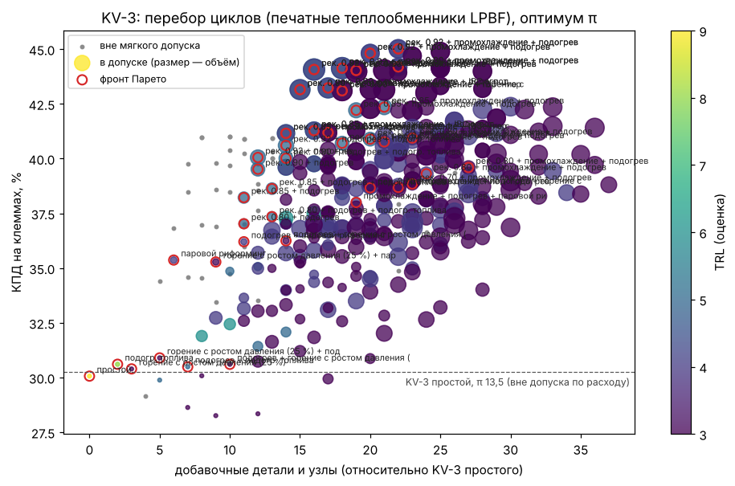
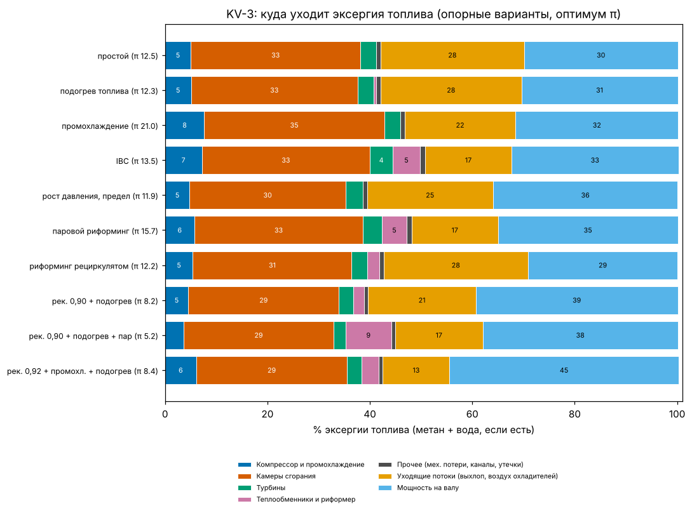

# KV-3: плотный перебор термодинамических циклов (organic/cycles)

Часть трека «Простая литая ГТУ-заменитель» (`routes/gtu`, issue #59), задача владельца 14.11.2026: «живая» геометрия и очень
плотная работа с термодинамикой. Приоритеты владельца: минимум отдельных деталей и узлов, Plug&Play в пакет Solar/Siemens,
простой монтаж и ремонт, затем КПД при наименьшем размере. Расчётная точка — KV-3 (Taurus 60 GS: 5670 кВт на клеммах,
5922 кВт на валу, вал 14 950 об/мин, T41 1000 °C, класс U — лопатки без охлаждения; `frame3`, `gtu_family`, сценарий «мягкий»).

Статус: **черновик, уровень облика (0D-цикл + 1D-размер теплообменников); все КПД узлов, потери, счёт деталей и TRL —
оценка.** Числа ниже — из `cycles_results.json` (поля указаны в скобках).

## Вывод: что реально стоит брать в KV

1. **Ограничение, которое решает всё, — мягкий допуск по расходу.** При T41 1000 °C пакет пропускает не больше
   1,2·21,41 = 25,69 кг/с воздуха, значит, удельная работа должна быть не меньше 230,5 кДж/кг (`feed_to_funnels.key_finding`).
   Простой цикл KV-3 на пределе: при π 13,5 — 26,20 кг/с, нужна T41 1008 °C; при π 12,55 — 25,68 кг/с и 30,06 % на клеммах
   (`base`). Это сходится с `frame3` (26,17 кг/с или 1010 °C).
2. **Рекуператор сам по себе в пакет не проходит.** Его потери давления снижают удельную работу: рекуператор 0,90 при π 3,67
   даёт 39,8 %, но 34,2 кг/с воздуха (+60 %); чтобы уложиться в допуск, нужна T41 1209 °C — класс K с охлаждаемыми лопатками
   (`results[R90-ic-rh-ibc-none-none].opt.T41_for_G_cap_C`).
3. **Главный рычаг — рекуператор вместе с межтурбинным подогревом на том же валу.** Подогрев возвращает удельную работу
   (267 кДж/кг), рекуператор забирает тепло горячего выхлопа:
   - рекуператор 0,90 + подогрев, π 8,2: **39,5 % на клеммах (+9,5 п. п.)**, 22,2 кг/с, выхлоп 363 °C, газ на входе в
     рекуператор 700 °C — ровно на пределе `LIM['T_rec_max']`; 12 добавочных деталей и узлов (колёс столько же, 2 + 3);
     сердцевина 2,28 м³ печатью (3 модуля BLT-S1500, 8,0 т Inconel 625) или 1,07 м³ фольгой (2,1 т); Plug&Play «частично»,
     TRL 5 (риск — межтурбинная камера малой одновальной машины);
   - **«как есть» — с компрессором KV-3 π 13,5: 35,7 % (+5,6 п. п.)**, 11 деталей и узлов, выхлоп 444 °C
     (`feed_to_funnels.recommended.as_is`). Это путь по шагам: KV-3 сначала простой, затем пакет «рекуператор + подогрев»
     без переделки компрессора;
   - печатный рекуператор, держащий газ 800 °C (Inconel 625, нужна проверка ползучести), — 41,0 % при π 5,3 (`trec800`).
4. **Промохлаждение воздух-воздух (без воды) работает, но громоздко.** С рекуператором оно даёт наибольшие КПД — 43,2 %
   (рекуператор 0,90) и 44,8 % (0,92 + подогрев), но охладитель на атмосферном воздухе с вентилятором добавляет 1,4–2,0 м³
   сердцевины, суммарно 8–10 м³ с коллекторами — Plug&Play «нет» по объёму; компромисс — рекуператор 0,85 + промохлаждение
   + подогрев: 42,2 %, 19 деталей, 5,6 м³, «частично». Вариант для заказчиков с местом, не для KV-3 «в пакет».
5. **Дёшево и сразу: подогрев топлива выхлопом до 400 °C** — +0,55 п. п. (30,61 %) за 2 детали, 0,05 м³, TRL 8.
6. **Не брать в KV:**
   - паровой риформинг — нужна вода (3,9 т/ч), Plug&Play «нет»; при π 13–16 выхлоп KV-3 холодный (444 °C), риформер работает
     при 404 °C, превращение метана 5,7 %, теплотворность +1,2 % — выигрыш +5,3 п. п. почти целиком от впрыска пара,
     а не от химии; в связке «рекуператор + подогрев» химия заметна (730 °C, превращение 54 %, +12,9 % теплотворности),
     но КПД ниже, чем без пара (38,2 против 39,5 %): теплота испарения уходит с выхлопом;
   - риформинг рециркулятом выхлопа «без воды» — в обеднённом выхлопе ГТУ кислорода в 3–4 раза больше, чем CO2 и H2O
     вместе (O2/CH4 0,075, H2O/CH4 0,027, CO2/CH4 0,014 при R 0,5): кислород сжигает метан, теплотворность падает
     (−3,3 %; −1,0 % в связке с рекуператором), сажа термодинамически выгодна (активность углерода 7–10), нужен компрессор
     рециркуляции с охладителями; КПД ниже простого (29,3 %);
   - IBC — +2,7 п. п. (32,7 %), но колесо компрессора IBC при 14 950 об/мин имеет коэффициент расхода 0,56 (предел 0,15):
     нужен отдельный вал около 5800 об/мин и колесо 1,24 м плюс охладитель 1,9 м³; TRL 4;
   - горение с ростом давления — идеальный предел +6,1 п. п. (эквивалентное давление 1,22·p3 при π 13,5), но при 25 %
     реализации и потере КПД турбины 2 п. п. остаётся +0,33 п. п.; TRL 3;
   - подогрев без рекуператора — выхлоп 578 °C у предела, КПД 29,9 % (ниже простого); зато расход 20,5 кг/с — двигатель
     меньше; имеет смысл только вместе с рекуператором.
7. **Где «живая» геометрия окупается** — см. раздел ниже: печатные модули рекуператора с деревом-распределителем на
   воздушной стороне и межтурбинная камера в переходном канале. Сердцевину по массе выгоднее делать фольгой или печатью с
   тонкой стенкой.



*Рисунок 1. Каждая точка — оптимум одной из 576 топологий (теплообменники LPBF). Серые — вне мягкого допуска; цвет — TRL
(оценка), размер — добавочный объём. Красные кольца — фронт Парето «КПД — детали — объём». Видно, что без теплообмена КПД не
поднимается выше 31–33 %, а рекуператор с подогревом даёт 38–40 % за 11–12 деталей; промохлаждение — до 45 % за 15–20.*



*Рисунок 2. Доли эксергии топлива: разрушение в узлах, уходящие потоки и мощность. В простом цикле камера разрушает 33 %,
выхлоп уносит 28 %. Рекуператор с подогревом снижает долю камеры до 29 % и уноса до 21 %; химическая рекуперация меняет долю
камеры меньше чем на 0,3 п. п.*

## Таблица опорных вариантов (оптимум π, теплообменники LPBF; `results[...].opt`)

| вариант | π | КПД на клеммах, % | расход воздуха, кг/с | выхлоп, °C | добав. детали и узлы | объём ×2, м³ | сердцевины LPBF / фольга, т | Plug&Play | TRL |
|---|---|---|---|---|---|---|---|---|---|
| простой | 12,55 | 30,06 | 25,68 | 471 | 0 | 0 | — | да | 9 |
| простой, π 13,5 (как есть) | 13,5 | 30,25 | 26,20 (вне) | 458 | 0 | 0 | — | нет | 9 |
| подогрев топлива 400 °C | 12,32 | 30,61 | 25,66 | 460 | 2 | 0,05 | 0,09 / 0,02 | частично | 8 |
| промохлаждение | 21,0 ¹ | 31,90 | 20,45 | 393 | 8 | 2,90 | 5,1 / 1,4 | частично | 6 |
| подогрев | 20,31 | 29,88 | 20,48 | 578 | 5 | 0 | — | да | 5 |
| IBC | 13,55 | 32,73 | 24,25 | 161 | 9 | 3,83 | 6,7 / 1,8 | частично | 4 |
| рост давления, 25 % | 12,94 | 30,39 | 25,68 | 464 | 3 | 0 | — | частично | 3 |
| рост давления, предел ² | 11,86 | 36,17 | 20,94 | 436 | 3 | 0 | — | — | 3 |
| паровой риформинг (S/C 3) | 15,66 | 35,37 | 22,29 | 292 | 6 | 0,73 | 1,3 / 0,3 | нет (вода 3,9 т/ч) | 4 |
| риформинг рециркулятом (R 0,5) | 12,23 | 29,34 | 25,68 | 479 | 10 | 0 | — | частично | 3 |
| рекуператор 0,90 | 3,67 | 39,76 | 34,19 (вне) | 245 | 7 (−2 колеса) | 7,84 | 13,7 / 3,7 | нет | 9 |
| рекуператор 0,85 + подогрев | 8,25 | 38,22 | 22,14 | 383 | 11 | 3,02 | 5,3 / 1,4 | частично | 5 |
| **рекуператор 0,90 + подогрев** | 8,22 | **39,52** | 22,20 | 363 | 12 | 4,56 | 8,0 / 2,1 | частично | 5 |
| то же, π 13,5 (компрессор KV-3) | 13,5 | 35,70 | 20,96 | 444 | 11 | 4,13 | 7,2 / 1,9 | частично | 5 |
| рекуператор 0,92 + подогрев | 8,22 | 40,05 | 22,22 | 355 | 12 | 5,61 | 9,8 / 2,6 | частично | 5 |
| рекуператор 0,90 + подогрев + подогрев топлива | 7,58 | 40,02 | 22,68 | 349 | 14 | 4,72 | 8,3 / 2,2 | частично | 5 |
| рекуператор 0,90 + подогрев + пар (S/C 1,5) | 5,17 | 38,20 | 24,94 | 290 | 18 | 5,48 | 9,6 / 2,6 | нет (вода 1,8 т/ч) | 4 |
| рекуператор 0,90 + промохлаждение | 5,59 | 43,15 | 25,69 | 204 | 15 (−1 колесо) | 10,13 | 17,7 / 4,7 | нет | 6 |
| рекуператор 0,85 + промохл. + подогрев | 8,96 | 42,21 | 19,02 | 281 | 19 | 5,62 | 9,8 / 2,6 | частично | 5 |
| рекуператор 0,92 + промохл. + подогрев | 8,40 | 44,81 | 19,49 | 239 | 20 | 8,17 | 14,3 / 3,8 | нет | 5 |

¹ край сетки π; ² граница, не вариант (в Парето не входит). Полная таблица — `cycles.csv` (576 топологий × оптимум и π 13,5
× два исполнения теплообменников), фронты — `pareto_lpbf` (42 варианта) и `pareto_lpbf_pnp` (19: Plug&Play не «нет», TRL ≥ 5).
Где IBC не даёт выигрыша, он не ставится, и такая топология совпадает с топологией без IBC — из фронтов она исключена (`degenerate`).

## Химическая рекуперация подробно (`reformer`)

Равновесие при S/C 2 (Cantera; превращение CH4 / прирост теплотворности на кг метана):

| T риформера, °C | 450 | 550 | 650 | 750 | 850 |
|---|---|---|---|---|---|
| 17 бар (давление топлива KV-3 при π 13,5) | 8 % / +1,6 % | 17 % / +3,5 % | 31 % / +6,8 % | 52 % / +12,1 % | 77 % / +18,6 % |
| 5 бар | 13 % / +2,6 % | 27 % / +5,7 % | 49 % / +11,1 % | 78 % / +18,6 % | 95 % / +23,3 % |

- Давление топлива KV-3 (1,25·p3 ≈ 17 бар) и холодный выхлоп (444–470 °C) — две причины, почему химия в простом KV-3 не
  работает. Подогрев поднимает газ за турбиной до 700–770 °C — и химия оживает, но вода остаётся.
- Сажа: при S/C 2 активность углерода 0,33–0,48 — равновесный газ сажу не даёт; сухой риформинг CH4 : CO2 = 1 : 1 —
  2,6–23 (сажа выгодна при всех температурах до 850 °C); газ рециркуляции — 7–10. Активность посчитана по двум путям
  (разложение метана и Будуар) — в равновесном газе они совпадают; совпадение с многофазным равновесием с графитом — в тестах.
- Катализатор: Ni/MgAl2O4 (Xu & Froment, 1989) для парового; для газа, богатого CO2, устойчивее к саже Rh, Ru, но дороги
  (Pakhare & Spivey, 2014 — по выдержке поиска). Кинетика: 95 % равновесного превращения при 650 °C, 17 бар, S/C 2 — 0,20 кг
  катализатора на 1 моль/с метана; для варианта «рекуператор + подогрев + пар» (18,5 моль/с) — около 3,8 кг активного слоя,
  75 м² покрытия при 50 г/м² против 183 м² стенки риформера (`reformer.catalyst_estimate`; оценка, константы не сверены с
  оригиналом).
- Разрушение эксергии в камере: простой цикл 33,1 % эксергии топлива → с паровым риформингом 32,9 %; «рекуператор +
  подогрев» 29,4 % → с паром 29,2 %, с рециркулятом 27,0 % (но эксергия уходит в компрессор и охладители рециркулята).

## Теплообменники, коллекторы, компромисс давления (`hx`, `recup_tradeoff`, `hx_wall_sensitivity`, `murray`)

- Рекуператор 0,90 варианта «+ подогрев»: противоток, Re около 460 (ламинар), длина 0,32 м, фронт 7,1 м², сердцевина
  2,28 м³ (печать) или 1,07 м³ (фольга); масса 8,0 / 2,1 т.
- **Стенка печати решает массу:** Dh 2 мм и стенка 0,35 мм — 8,0 т и 3 модуля; стенка 0,25 мм — 5,7 т; Dh 1,5 мм и
  0,20 мм — 3,4 т и 2 модуля; Dh 3 мм и 0,5 мм — 17,1 т и 5 модулей.
- **В ламинарном режиме потеря давления покупает форму, а не объём** (минимум производства энтропии Бежана при ламинарном
  течении — к нулевому Re; по выдержке поиска). При степени регенерации 0,90 суммарная потеря 3 % вместо 6 % даёт +0,7 п. п.
  (40,2 против 39,5 %), объём меняется на 3 % (2,21 против 2,28 м³), а фронт растёт с 7,1 до 9,9 м². Потери 9 % и больше
  выводят вариант из допуска по расходу.
- Дерево-распределитель (H-дерево на лицевой поверхности 7,1 м², деление до площадки 0,1 м, 10 уровней):
  - воздушная сторона (4,4 м³/с при 8 бар): по Мюррею (показатель 3) — 2,0 кПа из бюджета 6,2 кПа и 1,3 м³;
    показатель 7/3 — 3,7 кПа и 0,8 м³; сохранение площади — 8,5 кПа (не проходит);
  - газовая сторона (58 м³/с при 1 атм): 142–594 Па из 1123 Па, но 8,6–17 м³ — больше самой сердцевины. На газовой
    стороне дерево не окупается: кольцевой коллектор вокруг диффузора выхлопа и связность гироида, растекающая поток внутри.
- Реальный масштаб места: пакет Mercury 50 (4,6 МВт с рекуператором) больше пакета Taurus 60 GS на 49,9 м³ и тяжелее на 7,8 т
  (`pack_reference`) — добавочный объём «рекуператора + подогрева» по расчёту (4,6 м³ с коллекторами) на порядок меньше.

## Где «живая» геометрия работает на цикл (физика, а не украшение)

1. **Сердцевина рекуператора — решётка TPMS (гироид) с переменной плотностью.** Гироид делит объём на два несвязанных
   лабиринта — воздух и газ — одной непрерывной стенкой: модуль печатается одной деталью без пайки. Расчёт здесь
   консервативен (ламинарные плоские каналы: Nu 7,54, f·Re 24); интенсификация гироида уменьшит объём, но не массу — массу
   задают площадь и стенка печати. Переменная плотность (мельче ячейка там, где разность температур мала) выравнивает
   производство энтропии по длине. Задача для облака — периодическая ячейка гироида в CFD с теплообменом (Nu и f·Re при
   Re 300–800) вместо постоянных плоского канала.
2. **Коллекторы — дерево по закону Мюррея на воздушной стороне** (выше: 1,3 м³ и 2,0 кПа при показателе 3), печатается за
   одно с корпусом модуля — меньше деталей, чем у паяных коробов. На газовой стороне — кольцевой коллектор.
3. **Межтурбинная камера подогрева в переходном канале турбины.** Подогрев — главный приём «простоты»: без него рекуператор не
   проходит по расходу. Кольцо форсунок в стойках канала не добавляет корпуса; вход — газ после первой ступени, около 825 °C,
   3,9 бар, кислород 17,7 % (по объёму) (`feed_to_funnels.combustor_funnel.conditions`). Стойки-форсунки — деталь для печати.
4. **Рекуператор вокруг двигателя:** кольцевые печатные модули на диффузоре выхлопа сокращают газоходы и компенсаторы —
   именно их считает перечень деталей (4 из 12 добавочных у рекомендуемого варианта — газоходы и компенсаторы).
5. **Чего печать не даёт:** печатная стенка 0,35 мм против фольги 0,1 мм — сердцевина в 3,7 раза тяжелее. Печать — для
   коллекторов, корпусов и неразъёмных узлов; сердцевина — фольга или печать с тонкой стенкой, если принтер её держит.

Источники для этих пунктов — в конце (Мюррей 1926, Uylings 1977, Бежан — по выдержке поиска).

## Метод (уровень облика, всё — оценка)

**Цикл.** Один вал, частота пакета 14 950 об/мин, T41 1000 °C, мощность на валу 5922 кВт. Свойства газа — Cantera (GRI-Mech 3.0,
восемь веществ), полное сгорание, политропные процессы 40 шагами — как `gtu_cycle`. КПД узлов — из `frame3`: компрессор 0,8413
при π 13,5 (две центробежные ступени), турбина 0,8846; для других π КПД ступени — формула трека `comp_stage` с поправкой,
дающей 0,8413 при π 13,5; одна ступень до π 5, две — выше. Утечки 1,5 %, потери камеры 4 %, противодавление выхлопа 1,02,
механический КПД 0,99, генератор 0,972, редуктор 0,985. Число ступеней турбины — по работе ступени ≤ 1,5·U², U = 420 м/с.

**Топологии** — 6 × 2 × 2 × 2 × 3 × 4 = 576; у каждой — оптимум π (сетка 3–21 и уточнение) и параметров, и точка «как есть»
(π 13,5):

| признак | значения | как считается |
|---|---|---|
| рекуператор | нет; 0,70; 0,80; 0,85; 0,90; 0,92 | противоток, эффективность по наименьшей теплоёмкости; потери 2,5 % (воздух) и 3,5 % (газ), как `gtu_cycle.recup`; газ на входе ≤ 700 °C (`LIM['T_rec_max']`) |
| промохлаждение | нет; воздух-воздух | между ступенями при √π: эффективность 0,80, потеря 2 %, холодный воздух — 1,5 теплоёмкости, вентилятор 500 Па, КПД 0,65 × 0,95; без воды |
| подогрев | нет; межтурбинная камера | после доли x_rh ∈ {0,35; 0,5; 0,65} логарифма перепада — снова до 1000 °C, потеря 3 % |
| IBC | нет; на выхлопе | расширение до {0,25…0,7}·P0, охлаждение воздухом (0,85) с конденсацией воды, сжатие до противодавления; КПД 0,86 и 0,82 |
| горение с ростом давления | нет; 25 %; предел | предел — эквивалентное располагаемое давление: продукты горения при постоянном объёме, стационарный поток с той же полной энтальпией и энтропией; 25 % — доля реализации и потеря 2 п. п. КПД турбины (оценка) |
| химическая рекуперация | нет; подогрев топлива; паровой риформинг; риформинг рециркулятом | газ за турбиной → риформер → рекуператор; давление топлива 1,25·p3; риформер ≤ T газа − 40 К и ≤ 850 °C, равновесие с подходом 15 К, пинч ≥ 20 К по составным кривым; S/C ∈ {1,5; 2; 3}; рециркулят — газ за рекуператором, R ∈ {0,5; 1; 2; 4} моль на моль CH4, охлаждение воздухом до 80 °C и две ступени сжатия с промохлаждением (КПД 0,78) |

**Мягкий допуск пакета** (решение владельца 14.11.2026): воздух ≤ 25,69 кг/с, выхлоп ≤ 1,2·21,77 = 26,12 кг/с, ≤ 610 °C.
Выбор точки — сначала выполнение допуска, затем наибольший КПД на клеммах. Для вариантов вне допуска по расходу записана
T41, при которой он выполняется (`T41_for_G_cap_C`).

**Теплообменники.** Пластинчатая противоточная сердцевина, оба тракта — плоские ламинарные каналы. Постоянные развитого
ламинарного течения посчитаны здесь же конечными разностями: f·Re = 24,000, Nu = 8,235 (постоянный поток) и 7,541
(постоянная температура стенки); в расчёт идёт 7,541 — без выигрыша входного участка и интенсификации. UA = Q/LMTD
(у риформера — интеграл по составным кривым), A = UA/U, длина — по более жёсткой из допустимых потерь (70 % — сердцевина,
30 % — коллекторы), объём = A·(Dh/2 + t). Исполнения: `foil` — фольга 0,1 мм, Dh 1,5 мм, корпус и коллекторы +100 % массы;
`lpbf` — печать Inconel 625, стенка 0,35 мм, Dh 2 мм, +60 %, модули по камере BLT-S1500 (1500 × 1500 × 1200 мм, заполнение 40 %).

**Риформинг.** Равновесие — Cantera; активность углерода — по разложению метана и по Будуару со стандартными потенциалами при
1 атм (в Cantera `standard_gibbs_RT` идеального газа — при текущем давлении; пересчёт учтён); кинетика — Xu & Froment в
изотермическом реакторе идеального вытеснения с константами равновесия из Cantera (с эмпирическими формулами модели —
в пределах 4,5 %, `reformer.keq_check`).

**Эксергия.** Среда ISO 3977-2 (15 °C, 101,325 кПа, 60 %) — как `organic/exergy`. Разрушение по каждому узлу двумя способами:
баланс эксергии узла (A) и T0·S_gen (B); расхождение — меньше 0,5 кВт, невязка баланса цикла — меньше 0,01 %. Химическая
эксергия метана — 834,3 кДж/моль (табличное 831,65 — по памяти; разница — определение среды).

**Детали, Plug&Play, готовность.** Добавочные детали и узлы — относительно KV-3 простого (2 колеса компрессора + 3 ступени
турбины): изменение числа колёс + перечень каждого приёма (модули сердцевин — по камере принтера; газоходы, компенсаторы,
клапаны, вентиляторы с двигателями, насосы, водоподготовка, катализатор), `parts.items`. Plug&Play: «нет» — нужна вода или не
выполнен допуск, или объём (×2 на коллекторы) больше 6 м³; «да» — без теплообменников и вспомогательных машин; иначе
«частично» (модуль на выхлопе или крыше пакета). Пороги и TRL — оценка (`trl_note`).

## Сверки и проверки

- Простой цикл против `gtu_cycle.cycle` в точке `frame3` (π 13,5, 25,55 кг/с): 5775,5 против 5780,9 кВт (−0,09 %), КПД на
  валу 31,60 против 31,63 %, выхлоп +0,19 К (`crosscheck.simple`). Разница — дробление политропы (40 шагов против 2 × 40).
- Рекуператор против `gtu_cycle.recup` (π 5, 0,85): 38,56 против 38,36 %, воздух за рекуператором 589,6 против 587,1 °C —
  разное определение эффективности (здесь по энтальпии наименьшей теплоёмкости).
- Схема «40 шагов» завышает работу на 0,28 % против сошедшегося интеграла (`crosscheck.poly_steps`) — один знак для всех.
- `test_cycles.py` — 22 проверки: постоянные ламинарного канала, обе сверки, баланс камеры, эксергия двумя способами для девяти
  топологий, монотонность рекуператора, размер теплообменника, константы равновесия, сходимость кинетики к равновесию,
  сажа против многофазного равновесия с графитом, теплотворность при рециркуляции, границы горения с ростом давления,
  функция Парето, состав файла результата.

## Ограничения и что дальше

- КПД узлов при π 5–9 (одна или две ступени при частоте пакета) — формула трека с поправкой; нужен расчёт ступеней (SU2).
- Межтурбинная камера — модель: потеря давления 3 % и полное сгорание; нужна воронка камеры (условия переданы) и CFD.
- Оптимум доли перепада до подогрева x_rh = 0,35 — на нижней границе сетки {0,35; 0,5; 0,65}; облачный перебор берёт 0,3–0,7.
- Теплообменники — ламинарные плоские каналы; для гироида нужны Nu и f·Re из CFD периодической ячейки; ползучесть и
  термоусталость печатной сердцевины при 700–800 °C — CalculiX (`*CREEP`).
- Кинетика Xu — Froment — константы по памяти; катализатор и его старение — вне модели.
- Горение с ростом давления — простейший вид «эквивалентного давления» без нестационарной турбины.
- Плотный перебор на облаке: `aws_jobs_cycles.json` — 864 топологии (степень регенерации до 0,94), π через 0,5,
  пять значений x_rh, S/C и R; проверено командой `plan` без AWS (c7a.16xlarge, сторож 60 мин, верхняя оценка 2,1 долл.);
  выполнимо после попадания файлов в ветку `claude/lucid-allen-yvps5d`. AWS не вызывался.

## Подача в воронки (`../feed_to_funnels.json`, ключ `cycles`; копия — `feed_cycles.json`)

- Воронка двигателя (`routes/gtu/funnel/funnel_space.py`): новые оси `reheat` (нет / межтурбинная камера), `x_rh` 0,3–0,7,
  `fuel_preheat`, `T_rec_max_C` (700 / 800), `recup_core_tech` (фольга / печать); `eps_rec` — только вместе с подогревом или
  промохлаждением; вес архетипа RDC снизить; модели `cycles.evaluate`, `cycles.size_hx`, `cycles.exergy_account`.
- Воронка камеры (`routes/gtu/combustor`): воздух на входе в камеру 590–670 °C (рекуперированные циклы); межтурбинная камера —
  вход около 825 °C, 3,9 бар, кислород 17,7 %; топливо до 400 °C; модели `cycles.burn`, `cycles.pgc_gain`, `cycles.carbon_activity`.

## Файлы

| файл | что это |
|---|---|
| `cycles.py` | расчёт: цикл, теплообменники, риформинг, эксергия, детали, Парето, графики, подача в воронки |
| `test_cycles.py` | 22 проверки pytest (около 1,5 мин; проверка файла результата — если он есть) |
| `cycles_results.json` | результат (сжатый, 3,7 МБ): `method`, `software`, `date`, `inputs`, `assumptions`, сверки, 576 топологий, фронты, исследования; полный (9 МБ) — в scratchpad, не в репозитории |
| `cycles.csv` | плоская таблица: топология × точка (оптимум, π 13,5) × исполнение теплообменников |
| `cycles_pareto.png`, `cycles_exergy.png` | рисунки 1 и 2 |
| `feed_cycles.json` | что подать в воронки (копия ключа `cycles` из `../feed_to_funnels.json`) |
| `aws_jobs_cycles.json` | задача облачного плотного перебора в формате `platform/aws/runner.py` |

```bash
python3 cycles.py                      # около 8–12 мин на 4 ядрах -> cycles_results.json, cycles.csv, PNG, feed
CYCLES_WORKERS=6 python3 cycles.py     # больше процессов
CYCLES_QUICK=1 python3 cycles.py       # 12 топологий, вывод в scratchpad — проверка вывода
python3 cycles.py --rebuild            # детали, фронты, таблица, подача и графики из полного результата без перебора
python3 -m pytest -q test_cycles.py
```

## Источники (статус: открыт / по выдержке поиска / по памяти — не открыт)

Файлы трека (открыты, числа взяты из них): `frame3/frame3_point_results.json` (КПД узлов, точка KV-3), `gtu_family_results.json`
(Taurus 60 GS: 5670 и 5922 кВт, 21,41 кг/с, 510 °C, пакет 9,8 × 2,6 × 3,2 м), `fleet/gtu_fleet_taurus60.json` (выхлоп 21,77 кг/с,
пакет 37 920 кг), `fleet/gtu_fleet_mercury50.json` (4600 кВт, 38,5 %, π 9,9, выхлоп 17,69 кг/с и 365 °C, рекуператор с первичной
поверхностью, пакет 11,1 × 3,2 × 3,7 м и 45 700 кг), `gtu_explore.py` (`LIM['T_rec_max']` = 700 °C), `gtu_cycle.py`, `gtu_family.py`.

Внешние:
- Xu J., Froment G.F., AIChE J. 35 (1989) 88–96 — источник подтверждён выдержкой поиска; константы — по памяти, с оригиналом не
  сверены (косвенно: эмпирические константы равновесия модели совпали с Cantera в пределах 4,5 %).
- Shah R.K., London A.L. Laminar flow forced convection in ducts (1978) — f·Re 24, Nu 8,235 и 7,541; по памяти, посчитаны заново.
- Kesser K.F., Hoffman M.A., Baughn J.W., J. Eng. Gas Turbines Power 116 (1994) 277–284 — химически рекуперированная ГТУ
  (выше простого цикла и впрыска пара, ниже ПГУ) — по выдержке поиска. Pashchenko D. и др., Energy 258 (2022) — по выдержке поиска.
- Pakhare D., Spivey J., Chem. Soc. Rev. 43 (2014) 7813 — Rh, Ru устойчивее Ni к саже, сухой риформинг требует 800–1000 °C —
  по выдержке поиска.
- Gülen S.C., J. Glob. Power Propuls. Soc. 1 (2017) — выигрыш горения с ростом давления — по выдержке поиска (число не получено).
- Xisto C. и др., Aerosp. Sci. Technol. 82–83 (2018) — нестационарный поток снижает КПД турбины — по выдержке поиска.
- Kaemming T., Paxson D., AIAA 2018-4567 — эквивалентное располагаемое давление — по памяти, не открыт.
- Bianchi M., De Pascale A., Applied Energy 88 (2011) 1500; GT2011-46236 — IBC — по выдержке поиска.
- WR-21 (промохлаждение и рекуперация; до 27–30 % экономии топлива, отказы промохладителя при воде теплее 30 °C) — по выдержке
  поиска (второстепенные источники).
- Mercury 50: фольга 0,1 мм из 347, позже Alloy 625 — по выдержке поиска.
- Принтеры: BLT-S1500 1500 × 1500 × 1200 мм; Eplus3D EP-M2050 2050 × 2050 × 1100 мм — по выдержке поиска.
- ISO/ASTM 52911-1:2019 (LPBF: стенки, нависания, вынос порошка) — по выдержке поиска, только оглавление; стенка 0,35 мм и
  канал 2 мм — оценка.
- Murray C.D., PNAS 12 (1926) 207 — показатель 3; Uylings (1977) — 7/3 — по выдержке поиска.
- Bejan A. Entropy generation minimization (1996); Bejan A., Lorente S. Design with constructal theory (2008) — по выдержке поиска.
- ISO 3977-2 (15 °C, 101,325 кПа, 60 %) — как в `organic/exergy`; Szargut (1988): 831,65 кДж/моль — по памяти.
