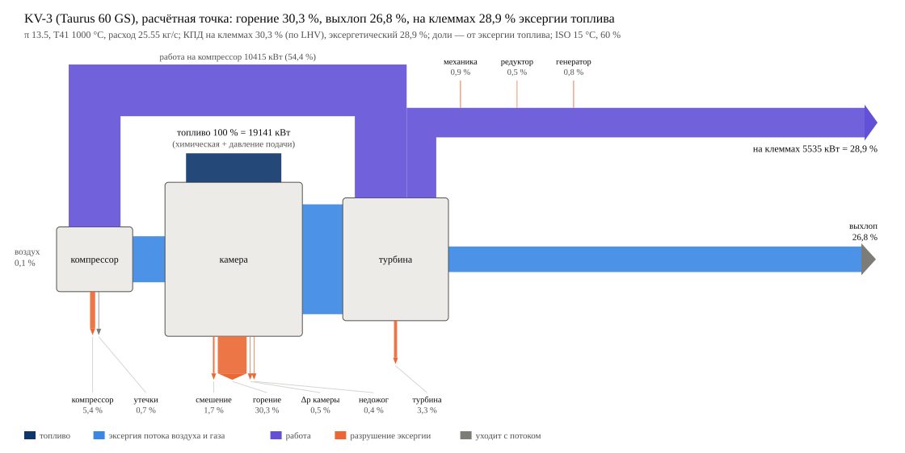
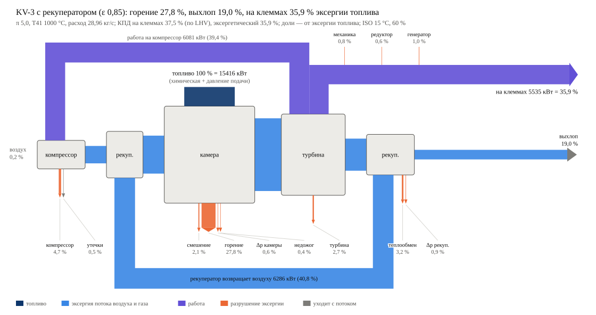
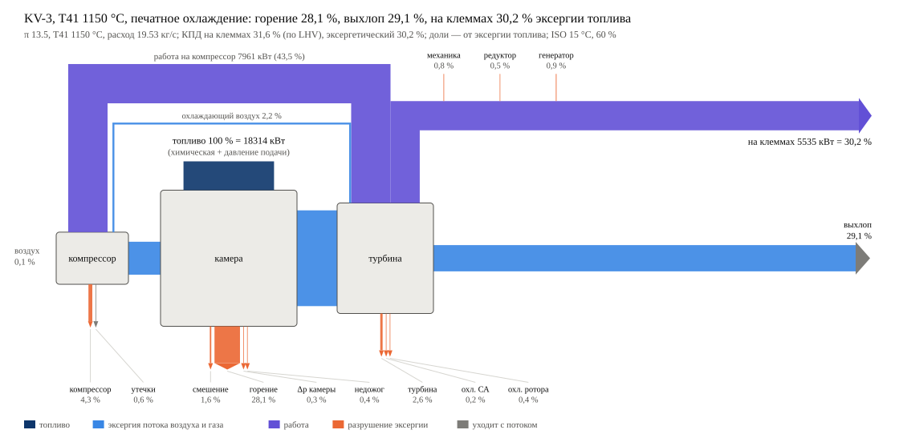
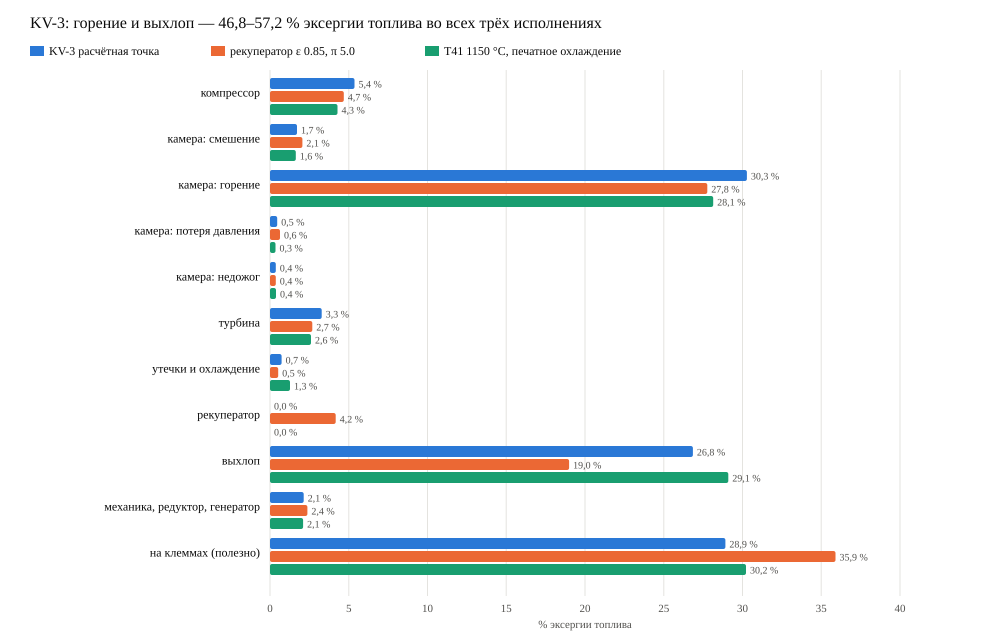

# KV-3: эксергетический анализ — где теряется работоспособность топлива и какой приём её возвращает

Часть трека «Простая литая ГТУ-заменитель» (`routes/gtu`, issue #59), направление «живая» геометрия
(`routes/gtu/organic/`, задача владельца 14.11.2026). Энергетический баланс говорит, сколько теплоты ушло;
эксергетический — где и сколько работы потеряно безвозвратно. Разрушение эксергии в узле равно T0·S_gen
(теорема Гюи — Стодолы): это прямой адрес для формы. Любая геометрия — дерево каналов, решётка, профиль после
сопряжённой оптимизации — возвращает КПД ровно на то производство энтропии, которое она убрала, минус то, что
сдвинулось в соседние узлы. Здесь эти величины посчитаны по узлам для KV-3 и двух альтернатив.

Уровень — облик (0D), всё — **оценка**: КПД узлов и потери приняты в треке, модель охлаждения — принятая структура
с калибровкой по классу K трека. Каждое число ниже — из `exergy_results.json` (ключ указан).

## Файлы

| файл | что это |
|---|---|
| `exergy.py` | расчёт: цепочка состояний (копия `gtu_cycle.cycle_r`), эксергия потоков, разрушение по узлам двумя способами, три исполнения, перебор приёмов, SVG |
| `exergy_results.json` | результат; поля `method`, `software`, `date`, `inputs` (файл и поле каждого входа), `assumptions`, `variants`, `reserve`, `feed_to_funnels` |
| `test_exergy.py` | 12 проверок pytest: баланс, совпадение с моделью цикла, независимые формулы, повторяемость |
| `grassmann_kv3_base.svg`, `grassmann_kv3_recup.svg`, `grassmann_kv3_hot_printed.svg` | диаграммы Грассмана (поток эксергии) трёх исполнений, один масштаб |
| `exergy_groups_kv3.svg` | сравнение исполнений по группам узлов |

```bash
python3 exergy.py                      # 5–6 мин CPU на одном ядре -> exergy_results.json и *.svg
python3 -m pytest -q test_exergy.py    # около 1 мин (нужен готовый exergy_results.json)
```

Зависимости — как у `gtu_cycle.py` (cantera 3.2.0, numpy, scipy). Вход: `../../frame3/frame3_point_results.json`,
`../../gtu_cycle.py`, `../../gtu_explore.py` (`LIM`), `../../gtu_family.py` (`COOL`). AWS не вызывается.

## Метод

1. **Цепочка состояний.** `chain()` повторяет `gtu_cycle.cycle_r` операция в операцию (те же `poly_process`,
   смешение `ct.Quantity` при HP, те же допуски `brentq`) и сохраняет все промежуточные состояния: вход, выход
   компрессора, воздух и топливо перед камерой, смесь до реакции, продукты при p3 и p4, после недожога, после
   подмешивания охлаждения, за частью турбины, вращающей компрессор, за всей турбиной, за рекуператором. В каждом
   прогоне мощность, расход топлива и выхлоп сверяются с `cycle`/`recup` (расхождение 0 до 1e-13,
   `variants.*.model_check`).
2. **Среда отсчёта** — ISO 3977-2: 15 °C, 101,325 кПа, RH 60 % (по выдержке поиска). Сухой воздух модели
   (`gtu_cycle.AIR`) + водяной пар: x_H2O = 0,01008 (`assumptions.environment`, p_sat — `ct.Water`). Химические
   потенциалы N2, O2, Ar, CO2, H2O — Cantera при T0, p0; метана — через реакцию CH4 + 2 O2 → CO2 + 2 H2O.
3. **Эксергия потока** = тепловая + от давления + химическая (состав заморожен; полные параметры, кинетическая
   отдельно не считается). Эксергия топлива — при подаче: химическая 834,31 кДж/моль = 52,005 МДж/кг (отношение к
   LHV модели 50,03 — 1,0395) и от давления подачи p3 0,389 МДж/кг (в модели топливо подаётся при p3, топливный
   компрессор не считается) — `variants.base.fuel`, `fuel_exergy_check`. Сухой воздух на входе относительно
   влажной среды несёт 0,84 кДж/кг (0,11 % эксергии топлива) — он учтён во входе.
4. **Разрушение по узлам двумя способами:** (A) баланс эксергии узла: вход − выход − работа; (B) T0·S_gen по
   энтропиям потоков (для недожога — плюс Q/T0: модель снимает недожог как теплоту, граница — среда).
   A − B для узла — его невязка энергии; у всех узлов не больше 1e-6 % эксергии топлива. Компрессор разбит на
   две ступени (π и КПД ступени 1 — frame3, КПД ступени 2 — тот, при котором выход совпадает: 0,8391 против
   0,8391 во frame3, `variants.base.compressor_stages`); турбина — на три ступени frame3 (сумма сходится с цепочкой
   до 0,13 %, `variants.base.turbine_stages`).
5. **Баланс двигателя** (способ B): эксергия топлива + воздуха = мощность на клеммах + Σ T0·S_gen + эксергия
   выхлопа и утечек. Требование задачи — невязка не больше 0,5 % эксергии топлива; скрипт останавливается, если
   больше. Итог: 3·10⁻⁶ % у расчётной точки, не больше 3·10⁻⁵ % у всех семи исполнений
   (`variants.*.balance.residual_B_pct_fuel_ex`). Баланс уже поймал ошибку: в первой версии не было
   дросселирования охлаждающего воздуха от p3 до давления подмешивания — у исполнения с охлаждением невязка была
   0,34 %; узлы `cool_throttle_ngv` и `cool_throttle_rotor` её закрыли.
6. **Сравнение исполнений** — при одной мощности на валу (5781 кВт, как у расчётной точки): расход пересчитан,
   модель линейна по расходу.
7. **Охлаждение** (исполнение с повышенной T41): доля воздуха ряда x = K·ε/(1−ε), ε = (T_газа − T_стенки)/(T_газа −
   T3) — структура Holland & Thake (1980) и Horlock et al. (2001); раздельно сопловой аппарат и ротор (в роторе —
   относительная температура, ступень 1 frame3: на 102,3 К ниже T41). Допустимая температура — граница класса U
   трека (газ до 1000 °C без охлаждения). K литья подобран так, чтобы при 1200 °C получить класс K трека
   (5,5 % + 5,5 %, `gtu_family.COOL`). Печать: K умножен на η_c,литьё/η_c,печать = 0,5/0,75 (эффективность
   внутреннего охлаждения; оценка — печатные каналы у стенки, решётки и ветвление). Проверка не по калибровке:
   при 1050 °C модель литья даёт 2,75 % против 3 % класса N трека (`hot_sweep.rows`).

## Итог: три исполнения при одной мощности на валу

Ключи: `variants.base`, `variants.recup`, `variants.hot_printed`. Доли — от эксергии топлива.

| | KV-3, расчётная точка | с рекуператором | T41 1150 °C, печатное охлаждение |
|---|---|---|---|
| π; T41; расход воздуха | 13,5; 1000 °C; 25,55 кг/с | 5,0; 1000 °C; 28,96 кг/с | 13,5; 1150 °C; 19,53 кг/с |
| КПД на валу / на клеммах (LHV) | 31,63 / 30,28 % | 39,16 / 37,49 % | 33,06 / 31,65 % |
| эксергетический КПД (клеммы) | 28,92 % | 35,90 % | 30,22 % |
| эксергия топлива | 19 141 кВт | 15 416 кВт | 18 314 кВт |
<!-- GROUPS -->

Что видно:

- **Горение — 28–30 % эксергии топлива во всех трёх исполнениях**: это крупнейшее и самое «упрямое» разрушение
  (реакция при большой разности химических потенциалов). Геометрией камеры его не убрать; его снижают только
  горячий воздух на входе в камеру (рекуператор) и более высокая температура продуктов (T41). Форма камеры
  (подвод воздуха, смешение, Δp) отвечает за 2–2,7 %.
- **Выхлоп — второй адрес (27 % у расчётной точки)**: в простом цикле его снимает только рекуператор (до 19 %);
  повышение T41 при той же π выхлоп даже увеличивает (29,1 %): горячее за турбиной.
- **Компрессор (5,4 %) больше турбины (3,3 %)** — у KV-3 сжатие идёт двумя центробежными ступенями с узким
  безлопаточным диффузором; это главный адрес «машинной» части.
- Механика, редуктор и генератор — 2,1 %: редуктор и генератор принадлежат пакету и при замене двигателя
  остаются (Plug&Play), двигатель их не снимает.

Диаграммы Грассмана (ширина полосы ∝ потоку эксергии; петля сверху — работа турбины на привод компрессора,
снизу у рекуператора — возврат теплоты выхлопа воздуху):






<!-- REST -->
