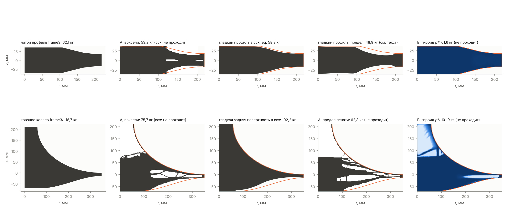
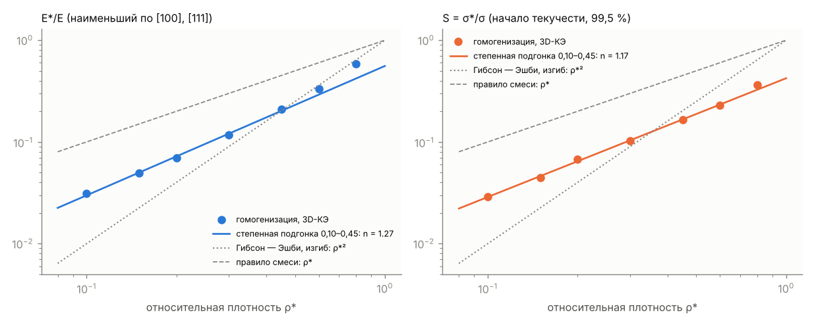
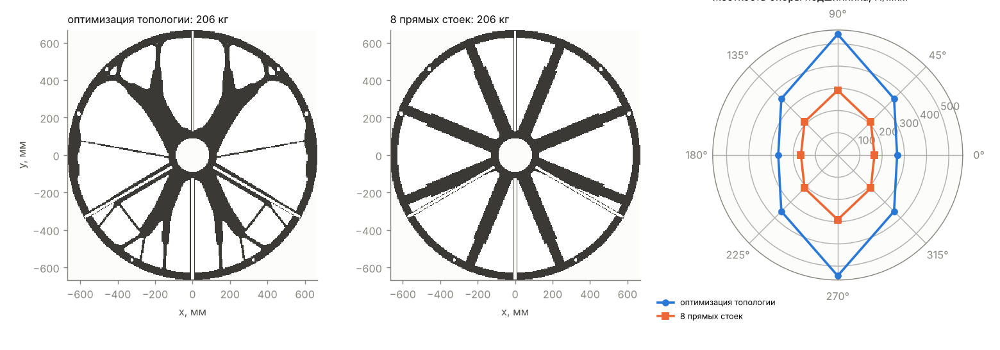

# KV-3: генеративная геометрия ротора и корпуса (organic/structure)

Часть трека «Простая литая ГТУ-заменитель» (`routes/gtu`, issue #59), задача владельца 14.11.2026: «живая» геометрия,
не очевидная и похожая на организм, при плотной работе с физикой. Приоритеты владельца: минимум отдельных деталей и узлов,
Plug&Play в пакет Solar/Siemens, простой монтаж и ремонт, затем КПД при наименьшем размере. Расчётная точка — KV-3
(Taurus 60 GS, вал 14 950 об/мин; профили колёс и дисков, поля температур, нагрузки лопаток — `frame3/frame3_fea_results.json`).

Статус: **черновик, уровень облика.** Все КПД, поля температур, допускаемые (materials.json — по выдержкам поиска),
коэффициент печати k_AM = 0,9, обшивка 2 мм, размеры рамы и коллектора — **оценка**. Числа ниже — из results-JSON узла
(поле в скобках). Ничего не закоммичено, AWS не вызывался.

## Главное (что проверено, а что нет)

1. **Проверенный выигрыш дала доводка гладкого профиля прямо в CalculiX** (`disk.py`, сетка 160×24, те же нагрузки и поле
   температур, что у исходного профиля frame3):
   - **колесо компрессора ступени 2 (Ti-6Al-4V): 102,2 кг против 118,7 кг (−14,0 %), момент инерции 3,05 против
     3,94 кг·м² (−22,8 %)** при том же наибольшем σ/σ0,2: 0,5536 / 0,7894 при 100 / 120 % против 0,5542 / 0,7899;
     запас по разрушающей частоте 2,03 против 1,89. Меняется только задняя поверхность, тракт и обод — как у кованого колеса
     (`structure_results.json → compressor_wheel_stage2.profile_eq`, `profile_opt_comp2.json`). COBYLA остановилась по пределу
     70 оценок — выигрыш не предельный;
   - **диск турбины ступени 1 (IN-713C, поле cooled_750): 58,8 кг против 62,1 кг (−5,3 %), J −5,6 %** при не худших
     запасах по всем трём критериям: местный ресурс по Ларсону — Миллеру 1,082·10⁶ против 1,080·10⁶ ч, местный σв/σ при
     120 % 1,028 против 1,015, запас по разрушению 1,398 против 1,397 (`turbine_disk_stage1.profile_eq`);
   - тот же диск «до предела материала» (ресурс 25 000 ч, σв/σ ≥ 1 при 120 %): 48,9 кг (−21 %), но на сетке 160×24 ресурс
     18 929 ч (на сетке поиска 80×12 — 25 000 ч): **нужна доводка**, брать как верхнюю оценку (`profile_lim`).
2. **Оптимизация топологии (плотностный метод) показала, где «живая» форма возможна, но её проекты не прошли проверку
   на гладкой геометрии.** В воксельной модели колесо получило полый носок ступицы, тороидальные полости в полотне и
   сформованную заднюю поверхность (75,7 кг, −36 %, ограничения выполнены в двоичном виде), диск турбины — ступицу на всю
   высоту и тонкое полотно (53,2 кг, −14 %) с щелевой полостью на средней плоскости у уступа. В CalculiX на гладком контуре
   (Gmsh CAX6) загрузка у колеса 1,44 при цели 0,80, у диска 1,28–1,45 при целях 0,74 / 0,99: пики у вершин линзовидных
   полостей, у тонких перемычек и на уступе ступицы — воксели 1–1,5 мм их «затупляют» (`ccx_check_results.json`). Это
   известная слабость ограничений по напряжению на ступенчатой границе; лечится доводкой формы (п. 1) и мелкой сеткой
   (задача AWS `struct-axi-fine`).
3. **Решётка (полый печатный ротор с гироидом) в роторе не окупается.** Закон гироида посчитан своим 3D-КЭ:
   E*/E ≈ 0,56·ρ*^1,27, прочность S ≈ 0,42·ρ*^1,17 (ρ* 0,10–0,45). При нагрузке, заданной деформацией (вращение, нагрев),
   решётка несёт почти то же напряжение, что сплошной металл (S/E ≈ 0,9), а выигрывает только снятием массы. Итог:
   диск турбины B — 61,6 кг (−0,7 %, средняя ρ* 0,99 — решётку вытеснил металл), колесо B — 101,9 кг при загрузке 0,94
   против 0,80 (не проходит). Место решётки — статорные детали: теплообменники, заполнитель стенок оболочки, демпфирование.
4. **Корпус-оболочка одной деталью окупается по деталям и жёсткости.** По модели деталей воронки (`funnel/parts_model.py`):
   традиционный KV-3 — 319 деталей и 978 единиц крепежа, печатная оболочка (корпус, диффузоры, корпуса подшипников,
   жаровая труба и сопловые аппараты заодно) со встроенными каналами — 208 и 282: **−111 деталей, −696 единиц крепежа,
   −12 трубных соединений** (`shell_results.json → parts`). Рама опоры подшипника, выращенная оптимизацией топологии, при той
   же массе **в 1,62 раза жёстче** классических 8 прямых стоек по худшему направлению (2D, демонстрационная сетка).
5. **Встроенный топливный коллектор по закону Мюррея** (дерево 1 → 2 → 7 в стенке) против кольца с 14 трубками той же
   ёмкости: разброс расхода по форсункам 0 % по построению и 0,32 % (95-й процентиль) от допусков печати ±2 % против 1,8 %
   и 2,3 % у кольца; минус 15 деталей и 28 соединений. Оптимальный показатель Мюррея для турбулентного газа — 2,41, а не 3.
6. **Оболочки KV-1…KV-3 целиком влезают в камеры LPBF** BLT-S1500, Farsoon FS1521M-U, Eplus3D EP-M2050 (D = 1,7…2,1·D2;
   KV-3: 1,34 × 1,08 м при 1,9·D2); камеры — по выдержкам поиска (`funnel/make_model.PRINTERS`).



*Рисунок 1. Меридиональные сечения (ось — слева, r по горизонтали, z по вертикали; оранжевая линия — контур исходного
профиля frame3). Верхний ряд — диск турбины ступени 1, нижний — колесо ступени 2. Слева направо: исходный профиль;
воксельный проект оптимизации топологии (серое — металл; в CalculiX не проходит); гладкий профиль после доводки в CalculiX
(проверен); вариант «до предела»; вариант B — относительная плотность гироида (тёмно-синий — сплошной металл, светлый —
лёгкая решётка). Видно, что колесо «хочет» полый носок и тороидальные полости, а проверенный выигрыш даёт задняя
поверхность; у диска — более плавный переход к ободу и тоньше уступ ступицы.*

## Файлы

| Файл | Что это |
|---|---|
| `topo_axi.py` | осесимметричный КЭ (Q4, 2×2) + плотностный метод (RAMP / SIMP с линейным участком), фильтр, проекция Хевисайда, MMA, p-норма загрузки с сопряжёнными производными |
| `disk_topo.py` | постановки диска турбины 1 и колеса 2 (варианты A, B), исходный профиль в той же сетке, прогоны → `disk_topo_results.json` |
| `profile_opt.py` | доводка гладкого профиля в CalculiX (`disk.py` + COBYLA): `--mode eq|lim` (турбина), `--mode comp2` → `profile_opt_*.json` |
| `lattice.py`, `fe3d.py` | гироид: доля объёма, толщина листа, гомогенизация 3D-КЭ (периодические условия) → `lattice_results.json` |
| `ccx_check.py` | проверка в CalculiX произвольного сечения: Gmsh CAX6, CENTRIF, T(r), *CLOAD; разбор — функциями `disk.py` |
| `structure_post.py` | проверка проектов в ccx, профили турбины через `disk.py`, геометрия (STL), сводка `structure_results.json` |
| `shell_topo.py` | рама опоры подшипника (2D, min-max податливости), счёт деталей, посадка в камеры принтеров → `shell_results.json` |
| `manifold.py` | топливный коллектор: дерево по Мюррею против кольца → `manifold_results.json` |
| `topo3d.py` | 3D воксельная оптимизация (диск 1/8 с 68 лопатками; рама) — для AWS; демонстрация → `topo3d_demo_results.json` |
| `organic_geom.py`, `structure_figs.py` | контуры → многоугольники, STL телом вращения, сектор гироида, рендеры pyvista, рисунки |
| `make_jobs_structure.py` → `jobs_structure.json` | задачи AWS (раннер `platform/aws/runner.py`) |
| `test_structure.py` | 6 проверок (аналитика, конечные разности, MMA, гироид, соглашение *CLOAD) |
| `ccx_check_results.json`, `turb_sizing_results.json` | проверка воксельных проектов в ccx; неудачные попытки доводки утолщением (сохранены как есть) |
| `stl/` | уменьшенные STL (5,7 МБ всего); полные — `<scratchpad>/organic/stl/` |
| `structure_*.png`, `render_*.png` | рисунки и рендеры |

Полные поля (`disk_*.npz`), журналы, рабочие папки ccx и полные STL (до 111 МБ — сектор гироида) — в каталоге `$ORGANIC_OUT` (в этой сессии — scratchpad сессии, подкаталог `organic/`; по умолчанию — `<tmp>/organic_structure`). Постобработка (`structure_post.py`, рисунки) читает поля оттуда: перед запуском `export ORGANIC_OUT=<каталог>`.

## Команды

```bash
# окружение: python 3.13, numpy 2.5.3, scipy 1.18.1, gmsh 4.15.2, cantera 3.2.0, ccx 2.21 (как у узла platform/fea);
# плюс pip: pyvista 0.49.2, trimesh 5.2.1, scikit-image 0.26.0, shapely 2.2.0, pypardiso 0.4.7, pyamg 5.4.1,
#           mapbox-earcut, fast-simplification (рендеры и STL)
python3 test_structure.py                 # 6 проверок, ~2 с
python3 lattice.py --N 48 --conv          # гироид, ~15 мин на 4 ядрах (плотные ячейки — N 32: память)
python3 disk_topo.py --all                # 9 вариантов оптимизации топологии, 4 процесса, ~40 мин при свободных ядрах
python3 profile_opt.py --mode eq          # доводка профиля турбины в ccx (~45 оценок × 2 ccx), ~15 мин
python3 profile_opt.py --mode lim
python3 profile_opt.py --mode comp2       # колесо, 70 оценок, ~5 мин
python3 shell_topo.py; python3 manifold.py
python3 make_jobs_structure.py
python3 ../../platform/aws/runner.py plan jobs_structure.json --assume-price 1.0   # без AWS: код 0, прогноз 40,31 долл.
```

## Метод

**Оптимизация топологии в осесимметричной постановке** (`topo_axi.py`, `disk_topo.py`). Сетка Q4 в плоскости (r, z),
активны элементы внутри огибающей; ε = [εr, εz, εθ, γrz], dV = 2πr dA. Нагрузки: вращение ρω²r (зависит от плотности),
нагрев σ = D(ε − α(T)(T − 20 °C)), давление лопаток на ободе диска (158,45 МПа при 100 %, растёт как ω²), масса лопаток
колеса — радиальными силами на поверхности ступицы, f(r) = φρω²·hb(r)·2πr² (φ = 0,06 — frame3). Материал — E(T), α(T),
σ0,2(T), σв(T), Ларсон — Миллер из `platform/fea/materials.json` через `disk.load_material` (одна точка правды с ccx).
Интерполяции: RAMP q = 5 (конечное отношение массы к жёсткости в пустоте при массовой нагрузке — Bruyneel & Duysinx 2005)
для диска турбины; SIMP p = 3 с линейным участком ниже 0,1 для колеса (RAMP давал дешёвую «пену» под обшивкой тракта —
см. «Что не получилось»). Напряжение ослабляется множителем x̄^0,5 (qp-подход), загрузка u = σ_экв / σ_доп(T),
ограничение — p-норма (P = 10) с адаптивной нормировкой (Le et al. 2010), производные — сопряжённым методом (одна
факторизация на два случая и две сопряжённые задачи). Фильтр плотности радиуса 2,5h, проекция Хевисайда β 1 → 16
(у первых прогонов 32), MMA (Svanberg 1987) с подзадачей через двойственную задачу (L-BFGS-B). Цель — масса или полярный
момент инерции.

Расчётные случаи и допускаемые: LC1 — 100 % + нагрев, LC2 — 120 % + нагрев. Диск турбины (IN-713C): LC1 σ ≤ σ_LM(T, 25 000 ч),
LC2 σ ≤ σв(T) местно. Колесо (Ti-6Al-4V): LC1 σ ≤ k·σ0,2(T)/1,5, LC2 σ ≤ k·σ0,2(T). «eq» — загрузка не выше, чем у исходного
профиля в той же сетке (для колеса при k = 1 — эффект только формы); «lim» — u ≤ 1 (колесо — печатный металл, k = 0,9;
оценка, как `funnel/make_model.u_limit_comp`). Огибающая: диск турбины — осевой габарит ступицы литого диска (72,45 мм),
колесо — огибающая кованого профиля (тракт и задняя полость). Пассивны: слой 4 мм под пазами диска, обшивка тракта
колеса 3 мм, обод колеса, посадка на вал.

**Вариант B** — огибающая исходного профиля, обшивка 2 мм, внутри гироид ρ* ∈ [0,15; 1]; жёсткость и прочность решётки —
таблица гомогенизации (PCHIP в логарифмах), напряжение решётки сравнивается с её прочностью S(ρ*)·σ_доп.

**Гомогенизация гироида** (`lattice.py`, Andreassen & Andreasen 2014): ячейка N³ вокселей hex8, периодические условия,
шесть единичных деформаций, пустые воксели исключены. Прочность — начало текучести: при макронапряжении единичной
эквивалентной величины — 99,5-й процентиль местного σ_экв, худший из пяти видов (одноосное [100] и [111], двухосное, сдвиг,
всестороннее). Жёсткость — наименьшая по [100] и [111]. Решатель — PARDISO до 100 тыс. неизвестных, больше — AMG-CG
(PARDISO на ячейке 200 тыс. неизвестных занимал 7,8 ГБ и дважды был убит OOM; AMG совпал с PARDISO до 6 знаков).

**Доводка гладкого профиля в CalculiX** (`profile_opt.py`). Диск турбины: t(r) — PCHIP по узлам r = 0,06…0,19 м, у оси
t_max, обод — w; колесо: задняя поверхность — PCHIP по узлам 0,07…0,30 м, тракт и обод — кованые. Каждая оценка — два
расчёта `disk.py` (CAX8, 80×12, CENTRIF, поле температур, давление лопаток ∝ ω²; у колеса масса лопаток в плотности
столбца — как в frame3), COBYLA, итог перепроверен на сетке 160×24 вместе с исходным профилем.

**Проверка в CalculiX произвольного сечения** (`ccx_check.py`): контур x̄ = 0,5 (поле продолжено за огибающую значением
ближайшей ячейки, металл = огибающая − пустоты) → Gmsh CAX6 → ccx 2.21. Соглашение `*CLOAD` для осесимметричных элементов
определено опытом: полная сила по окружности (сравнение с решением Ламе для кольца — 0,015 %).

**Рама оболочки** (`shell_topo.py`): плоское напряжённое состояние, Q4 4,45 мм, 67 824 элемента; зоны — кольцо подшипника,
внутренняя полость (металла ≤ 30 %), проточная часть (загромождение ≤ 12 %), стенка 40 мм с шестью осевыми каналами
(топливо, отбор воздуха, дренаж, проводка); четыре радиальных канала в стенках заданных полых стоек (подвод масла сверху,
слив снизу самотёком, вентиляция, наддув уплотнений); лапы — две боковые. Цель — наименьшая податливость опоры подшипника
по худшему из 8 направлений и давления за компрессором (min-max через переменную-границу), SIMP p = 3, MMA. Сила
подшипника 25 кН — оценка для демонстрации (≈250 кг ротора на опору × 10 g).

**Коллектор** (`manifold.py`): сеть каналов с трением по Haaland и соплами форсунок Δp = K·m² (4 % p3 — оценка), газ —
метан (Cantera), Wf = 0,365 кг/с (frame3); дерево — диаметры из минимума перепада при объёме кольцевого варианта (SLSQP);
Монте-Карло 200 выборок с σ диаметра 2 %.

## Результаты подробно

### Диск турбины ступени 1 (`turbine_disk_stage1`)

| Вариант | Масса, кг | J, кг·м² | Местный ресурс, ч | σв/σ при 120 % | Запас по разрушению | Статус |
|---|---|---|---|---|---|---|
| литой профиль frame3 (disk.py 160×24) | 62,09 | 1,246 | 1,080·10⁶ | 1,015 | 1,397 | исходный |
| гладкий профиль, eq (disk.py 160×24) | **58,82** | **1,176** | 1,082·10⁶ | 1,028 | 1,398 | **проверен** |
| гладкий профиль, предел | 48,93 | 0,962 | 18 929 (80×12: 25 000) | 1,000 | 1,406 | нужна доводка |
| воксели, eq (ccx на гладком контуре) | 53,22 | — | 3 233 | загрузка 1,41 | 1,432 | не проходит |
| B, гироид, eq (воксели) | 61,61 | 1,230 | — | загрузка 0,76 / 0,98 при целях 0,74 / 0,99 | — | ρ* ср. 0,99, выигрыша нет |

Профиль eq: толщина 71,5 мм при r 60–90 мм, 61,9 / 45,5 / 36,4 / 34,6 мм при r 120 / 150 / 175 / 190 мм (литой: 72,45 мм до
r 107 мм, далее по Стодоле до 28,2 мм у r_b и скругление к ободу 34,5 мм) — уступ ступицы тоньше, переход к ободу
плавнее, наибольший Мизес при 120 % — у оси, ресурс определяет поверхность полотна у r = 174 мм.

### Колесо компрессора ступени 2 (`compressor_wheel_stage2`)

| Вариант | Масса, кг | J, кг·м² | Загрузка LC1 / LC2 | Статус |
|---|---|---|---|---|
| кованое колесо frame3, воксели (k = 1) | 118,61 | 3,928 | 0,798 / 0,758 | исходный |
| гладкая задняя поверхность (disk.py 160×24) | **102,17** | **3,046** | σ/σ0,2 = 0,554 / 0,789 (исх. 0,554 / 0,790) | **проверен** |
| A, eq, воксели (SIMP) | 75,72 | 2,127 | 0,759 / 0,715 (воксели); **1,44 / 1,34 (ccx)** | не проходит в ccx |
| A, eq: полости полотна заполнены + скругления R 4 мм (ccx) | 98,11 | 3,339 | 1,04 / 0,98 | не проходит (цель 0,80) |
| A, eq, мин. J, воксели | 81,69 | 2,233 | 2,46 / 2,37 | не проходит |
| A, предел печати (k = 0,9), воксели | 62,83 | 1,871 | 2,67 / 2,57 | не проходит |
| B, гироид, eq | 101,94 | 3,129 | 0,94 / 0,89 | не проходит |

У проектов A — 8–11 замкнутых полостей (тороидов): литьём не делаются, печатью — только с выносом порошка (отверстия) и
самонесущими сводами; доля границы с нависанием круче 45° при печати осью вверх — 0,41 (с учётом нижней грани на плите).



*Рисунок 2. Листовой гироид: точки — гомогенизация своим 3D-КЭ (N = 48, плотные — 32), линии — степенные подгонки на
ρ* 0,10–0,45, пунктир — Гибсон — Эшби для изгибной решётки (ρ*²), штрих — правило смеси (ρ*). Жёсткость растёт как
ρ*^1,27 (ближе к растяжению, чем к изгибу), прочность — как ρ*^1,17; анизотропия Зенера 1,04–1,14 (почти изотропен).
Сходимость при ρ* = 0,2: E*/E 0,0661 / 0,0684 / 0,0698 при N 24 / 32 / 48 — значения N = 48 консервативны на 2–3 %.
Толщина листа при ячейке 8 мм: 0,39 мм при ρ* 0,15, 0,52 мм при 0,20 (`lattice_results.json → sheet_thickness_mm`).*



*Рисунок 3. Рама опоры подшипника KV-3 (сечение, D 1,34 м, осевая длина 0,1 м): слева — оптимизация топологии
(ветвящиеся стойки сходятся к верху и низу стенки, каналы масла и воздуха — в стенках заданных полых стоек), в центре —
8 прямых стоек той же массы (205,8 кг), справа — жёсткость опоры подшипника по направлениям. Наименьшая жёсткость
267 против 165 Н/мкм (×1,62), наибольший Мизес 70 против 183 МПа при 25 кН и давлении за компрессором.*

Рендеры: `render_comp2_A_mass_eq.png` (полости колеса в вырезе 90°), `render_comp2_profile_eq.png`,
`render_turb1_profile_eq.png`, `render_comp2_B_gyroid.png` (сектор 40° полого колеса с гироидом ячейки 8 мм),
`render_shell_frame.png`.

### Корпус-оболочка: детали, принтеры, коллектор

| Узел (правила `funnel/parts_model.py`) | Традиционный KV-3 | Оболочка | Разница |
|---|---|---|---|
| корпуса (с разъёмом, корпуса подшипников) | 13 | 2 | −11 |
| камера сгорания (лист, 14 форсунок) | 34 | 3 | −31 |
| горячая часть (сопловые сегменты, корпус турбины) | 64 | 1 | −63 |
| маслосистема: трубки и коллектор → каналы в стойках | 6 | 1 | −5 |
| топливо: подвод → канал в стенке | 2 | 1 | −1 |
| всего деталей / крепёж (всего; фланцы 812 → 116) | 319 / 978 | 208 / 282 | −111 / −696 |

Оболочка KV-1 / KV-2 / KV-3 (D = 1,9·D2; L — по формуле длины ротора воронки, у KV-1 и KV-2 — в пропорции KV-3, оценка):
0,73 × 0,59 / 1,15 × 0,93 / 1,34 × 1,08 м — входит в BLT-S1500 (1500×1500×1200 мм), Farsoon FS1521M-U (Ø1530×1650 мм) и
EP-M2050 (2050×2050×1100 мм) при D = 1,7…2,1·D2. Одна деталь из одного сплава (IN625 или Haynes 282 — горячий конец)
тяжела для холодной части; практичнее две печатные детали (холодная Ti-6Al-4V + горячая) на одном хомуте — именно так
считает `parts_model` («печать» + hot_integral).

Коллектор: кольцо Ø25 мм с 14 трубками Ø12 мм × 0,35 м и дерево Ø42 → Ø32 → Ø14 мм одинаковой ёмкости 1,69 л; перепад в
каналах 2,0 и 1,7 кПа при Δp форсунки 55 кПа; Re ~10⁶.

## AWS (`jobs_structure.json`; `runner.py plan` — код 0, прогноз 40,31 долл. при допущении 1 долл./ч)

| Задача | Что | Сторож |
|---|---|---|
| `struct-lattice-n80` | гироид на сетке 80³ (сходимость прочности) | 90 мин |
| `struct-axi-fine` | все осесимметричные варианты на вдвое мелкой сетке (0,5 / 0,75 мм) | 300 мин |
| `struct-topo3d-disk-h20`, `-h15` | 3D диск турбины, 1/8 модели, 68 лопаток силами по пазам, ограничения по напряжению | 360 / 720 мин |
| `struct-topo3d-frame-n160` | 3D рама оболочки, 1,3 млн степеней свободы | 480 мин |

Код 3D проверен демонстрацией (`topo3d_demo_results.json`: диск 6 мм — 24 864 степени свободы, рама — 27 972; по 40 итераций,
по ~130 с). На шаге 6 мм дискретные силы лопаток дают пики у пазов (загрузка 1,35) — это проверка кода, не результат.
Перед прогоном узел нужно закоммитить в ветку `claude/lucid-allen-yvps5d` вместе с `lattice_results.json` и
`disk_topo_results.json`. Следующий шаг для AWS по итогам этой работы — оптимизация формы на гладкой сетке
(сопряжённая по форме или параметрическая, как `profile_opt.py`) после топологии, иначе 3D-проекты повторят п. 2.

## Проверки

- `test_structure.py`, 6 из 6: тонкий вращающийся диск — 0,003 % в центре, 0,04 % у обода; параболический нагрев — 0,01 %;
  сопряжённые производные против конечных разностей — 1·10⁻⁵ (группы «solid» и «lattice», два случая); MMA на выпуклой
  задаче — точное решение; доля объёма гироида — ±0,01; `*CLOAD` против Ламе — 0,015 %.
- Свой КЭ против CalculiX frame3 на исходных профилях: диск турбины — Мизес у оси 486,1 против 484,9 МПа, средние окружные
  333,9 против 333,2 МПа, запас по разрушению 1,395 против 1,397, σв/σ при 120 % 1,012 против 1,015; колесо — при той же
  модели массы лопаток 352,3 против 352,28 МПа, средние окружные 184,4 против 184,0 МПа, масса по вокселям 118,61 против
  точных 118,60 кг. Моя модель лопаток (силы на поверхности ступицы) даёт у оси 338,8 МПа (−3,8 %): нагрузка входит через корни.
- Цепочка ccx (Gmsh CAX6) на исходном профиле диска: 486,5 МПа, загрузка LC2 0,989 (σв/σ 1,011) — совпадает с `disk.py`.
- `disk.py` через `profile_opt` на исходном профиле воспроизводит frame3: 484,89 МПа, ресурс 1,08·10⁶ ч, запас 1,3966.

## Что не получилось (сохранено, чтобы не повторять)

- Пассивный обод диска от r_b упирал тонкое полотно в острый входящий угол — особенность напряжений в гладкой сетке
  (920 МПа). Исправлено: пассивен только слой 4 мм под пазами.
- RAMP q = 5 в колесе: обширная «пена» x̄ 0,03–0,15 под обшивкой тракта подпирала её; порог срезал — загрузка 1,3–2,0.
  Перешёл на SIMP с линейным участком.
- Цель «не хуже кованого» с печатным металлом k = 0,9 недостижима по построению (критична ось, высота ступицы фиксирована);
  ремонтные круги с такой целью разносили проект (загрузка 5–20). Сравнение формы — при k = 1, k_AM — отдельно.
- Стадия β = 32 и ремонтные круги на ней не двигали проект (чувствительности в чёрно-белой области почти нулевые).
- Доводка воксельного профиля турбины утолщением (k до 1,6) и «переходом как у литого» — не сошлись: утолщение полотна при
  ограниченной высоте ступицы нагружает ось, стык профилей даёт излом (`turb_sizing_results.json`).
- Гомогенизация на N = 48 при ρ* ≥ 0,45 — OOM (PARDISO 7,8 ГБ); соседние сессии держали нагрузку 18–30 на 4 ядрах.

## Ограничения

- Осесимметрия: лопатки — массой, пазы и окна в окружном направлении — только в 3D (AWS). Поле температур — T(r) frame3.
- Упругий расчёт; малоцикловая усталость пусков и ползучесть с перераспределением не считались.
- Допускаемые IN-713C и Ti-6Al-4V — по выдержкам поиска (materials.json); печатаемые жаропрочные сплавы (IN718, Haynes 282)
  в materials.json отсутствуют, поэтому печатный диск турбины не оценён по своему металлу.
- Замкнутые полости требуют выноса порошка (отверстия — концентраторы) — не моделировались.
- Рама — 2D, нагрузки демонстрационные; коллектор — 1D сеть без ударных потерь в тройниках.

## Источники (статус)

- C. Le, J. Norato, T. Bruns, C. Ha, D. Tortorelli. Stress-based topology optimization for continua. Struct. Multidisc. Optim.
  41 (2010) 605–620, doi:10.1007/s00158-009-0440-y — по выдержке поиска.
- M. Bruyneel, P. Duysinx. Note on topology optimization of continuum structures including self-weight. Struct. Multidisc.
  Optim. 29 (2005) 245–256, doi:10.1007/s00158-004-0484-y — по выдержке поиска.
- K. Svanberg. The method of moving asymptotes — a new method for structural optimization. Int. J. Numer. Meth. Eng. 24 (1987)
  359–373, doi:10.1002/nme.1620240207 — по выдержке поиска.
- E. Andreassen, C. S. Andreasen. How to determine composite material properties using numerical homogenization. Comput.
  Mater. Sci. 83 (2014) 488–495, doi:10.1016/j.commatsci.2013.09.006 — по выдержке поиска.
- A. Bejan. Constructal-theory network of conducting paths for cooling a heat generating volume / tree networks. Rev. Gén.
  Therm. 36 (1997) 592–604 — по выдержке поиска; C. D. Murray (1926), закон куба радиусов — по выдержке поиска (обзоры
  конструктальной теории); показатель 3 — для ламинарного течения при заданном объёме.
- Листовые TPMS ближе к растяжению, показатель жёсткости гироида 1…2 — по выдержке поиска (обзоры Al-Ketan, Abu Al-Rub и др.);
  своё значение 1,27 — расчёт этого узла.
- Камеры принтеров — `funnel/make_model.PRINTERS` (по выдержкам поиска, ссылки там).
- Минимизация производства энтропии (Бежан) и сопряжённая оптимизация формы — направления; в этом узле не реализованы
  (сопряжённая — только по плотности).

## Подача в воронки

`routes/gtu/organic/feed_to_funnels.json → structure`: ось «профиль ротора» (колесо −14 % массы, −23 % J; диск −5 %),
поправки массы и момента инерции ротора, отказ от оси «решётка в роторе», подтверждение счёта деталей оболочки, посадка в
камеры принтеров, ось камеры «коллектор» (неравномерность расхода по форсункам 1,8 % против 0 %).
